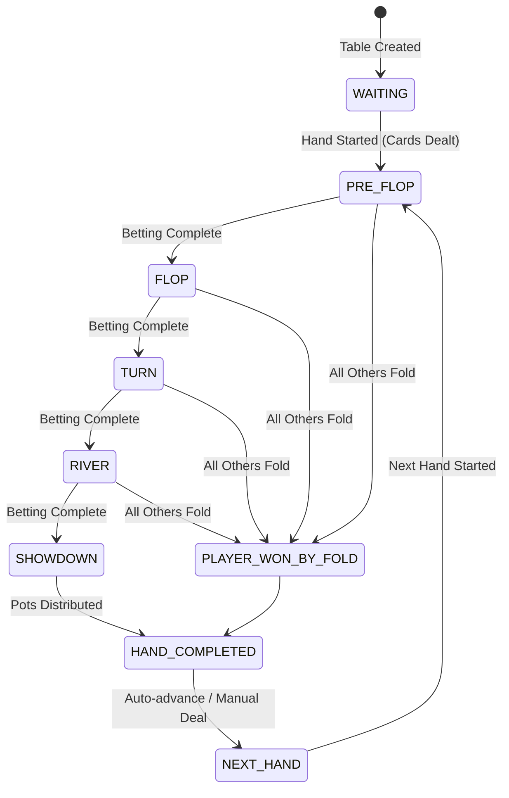

# Multiplayer Poker Project: Comprehensive Gameplay & Codebase Audit

**Date:** September 2026  
**Audited Stack:**
- **Frontend:** React 18, Vite, Tailwind CSS, Zustand, React Router 6, @stomp/stompjs
- **Backend:** Spring Boot 4.0.0-M2, Java 21, Maven, Spring Security (JWT)
- **Real-Time Layer:** STOMP over WebSocket (Spring Messaging + In-memory broker)
- **Database:** MongoDB 7 (Spring Data MongoDB)

---

## 1. Executive Summary

This codebase is a complete, production-grade, play-money multiplayer Poker platform supporting 5 distinct game variants (**Texas Hold'em**, **Omaha**, **Pineapple**, **5-Card Draw**, and **Razz**). The system features guest authentication, automated matchmaking with bot fallbacks, live STOMP WebSocket communication, in-memory concurrency locks with MongoDB durability, sanitized state projection (preventing card sniffing), and comprehensive automated test suites.

---

## 2. Architectural & Flow Analysis

```mermaid
flowchart TD
    A[User / Browser] -->|HTTP / REST| B[Spring Boot REST Controllers]
    A -->|STOMP / WS| C[GameWsController /ws]
    B --> D[TableService / MatchmakingService / AuthService]
    C --> D
    D --> E[TexasHoldemEngine & Variants]
    E --> F[HandEvaluator & PotManager]
    D --> G[(MongoDB 7 Database)]
    D --> H[GameBroadcaster]
    H -->|STOMP /user/queue/game/{tableId}| A
    I[BotOrchestrator / BotService] -->|Scheduled Decisions| D
```

### 2.1 Frontend Routing and Screens
- **`HomePage` (`/`):** Primary landing page featuring interactive cards for the 5 poker variants, quick-launch buttons, and a link to the lobby.
- **`PlayVariantPage` (`/play/:variant`):** Entry screen for instant play. Ensures guest session creation, initiates matchmaking, displays countdowns with bot fallback, and routes directly to `/game/:gameId`.
- **`LobbyPage` (`/lobby`):** Live table browser displaying open tables, seats occupied, blinds, variant type, and table creation modal (`CreateTableModal`).
- **`GamePage` (`/game/:gameId`):** Main gameplay arena. Renders poker table canvas, seated avatars, community cards, pot/side pots, action dock (`ActionPanel`), deal/chip animations, event sound effects (`usePokerSounds`), and showdown outcome overlays.
- **`LoginPage` / `RegisterPage` / `ProfilePage`:** Present as route placeholders/redirects to support guest-first auto-onboarding while retaining the underlying auth infrastructure.

### 2.2 Variant Selection Flow
1. User selects a variant on `HomePage` or `LobbyPage` (`TEXAS_HOLDEM`, `OMAHA`, `PINEAPPLE`, `FIVE_CARD_DRAW`, `RAZZ`).
2. Route transitions to `/play/:variant`.
3. `PlayVariantPage` acquires/verifies a valid JWT guest session via `POST /api/auth/guest`.
4. Matchmaking ticket is requested via `POST /api/matchmaking`.

### 2.3 Lobby Flow
1. `LobbyPage` fetches table summaries via `GET /api/tables`.
2. Tables display variant badge, blind structure, and seated player count (e.g. `2/6`).
3. User can click "Join Table" or "Create Table".
4. Table creation allows configuring Name, Variant, Small Blind, Big Blind, Max Players, and Starting Chips.

### 2.4 Matchmaking Flow
1. `MatchmakingService` receives `MatchmakingRequest`.
2. Checks if user is already seated at an active table (auto-resumes if true).
3. If not seated, groups players by matching queue key (`variant:smallBlind:bigBlind:maxPlayers:startingChips`).
4. **Human Match:** When `maxPlayers` are queued, creates table, seats all players, and starts hand immediately.
5. **Bot Fallback:** If elapsed wait time exceeds `poker.matchmaking.bot-fallback-ms` (default: 3.5s), creates a table for the human and seats bots in remaining slots.

### 2.5 Table Join / Create Flow
1. **Creation:** `TableService.createTable()` creates a `PokerTable` document in MongoDB and instantiates a `TexasHoldemEngine` in the in-memory map.
2. **Joining:** `TableService.joinTable()` validates seat availability, seats player in engine, saves MongoDB record, and publishes `PLAYER_JOINED` event.
3. State is broadcasted to all connected table subscribers via STOMP.

### 2.6 WebSocket Connection Flow
1. Client establishes WebSocket connection to `/ws`.
2. STOMP CONNECT frame includes `Authorization: Bearer <JWT>`.
3. `JwtHandshakeInterceptor` and `JwtStompChannelInterceptor` authenticate the user and assign `Principal(userId)`.
4. Client subscribes to `/user/queue/game/{tableId}` and `/user/queue/errors`.
5. Actions are published to `/app/game/{gameId}/action`.

### 2.7 Backend Game Engine Architecture
- **`TexasHoldemEngine`:** Central state machine driving table lifecycle, turn management, bet collection, dealer button progression, card dealing, and showdown resolution.
- **`PokerVariant` Polymorphism:**
  - `TexasHoldemVariant`: 2 hole cards, 5 community cards, standard high hand rules.
  - `OmahaVariant`: 4 hole cards, 5 community cards; showdown strictly requires 2 hole cards + 3 community cards.
  - `PineappleVariant`: 3 hole cards; requires 1 discard prior to pre-flop betting.
  - `FiveCardDrawVariant`: 5 private cards, no community cards, draw/discard phase after first betting round.
  - `RazzVariant`: 7-card stud lowball; Ace-to-5 low hand evaluation (unpaired low hands win).
- **Concurrency & State Synchronization:** `TableService` employs table-level lock objects (`ConcurrentHashMap<UUID, Object> locks`) to ensure thread safety across incoming WebSocket commands, REST requests, and bot scheduler turns.

### 2.8 Player & Session Management
- Seamless guest creation (`guest-xxxx` format) with 24-hour expiration JWTs.
- `GameSessionRegistry` tracks active STOMP session subscriptions per table.
- Disconnect handling preserves player chips and folds on active turns after grace periods without destroying seat ownership unexpectedly.

### 2.9 Table Lifecycle & Game States


### 2.10 Leave / Exit Handling
- **`POST /api/tables/{tableId}/leave`:**
  - If between hands: Removes player from table and frees seat.
  - If during active hand: Folds player's hand, marks disconnected, advances turn or triggers fold-win if 1 player remains.
- Frontend registers `window.addEventListener('pagehide')` and unmount cleanup to gracefully vacate seats when navigating away.

### 2.11 Poker Action Validation
- Engine computes `LegalActions` for current turn seat:
  - `canFold`, `canCheck`, `canCall`, `canBet`, `canRaise`, `canAllIn`, `canDiscard`.
  - Precise min/max calculation (`minBetOrRaiseTo`, `maxBetOrRaiseTo`, `callAmount`).
- Server re-validates all incoming action requests against current player ID, seat, and chip stack before applying.

### 2.12 Hand / Round Lifecycle & Pot Management
- **`PotManager`:**
  - Manages main pot and fractional side pots for all-in scenarios.
  - Accurately tracks per-player contributions per round and aggregates pots at showdown.
- **`TurnManager`:**
  - Tracks dealer button, Small Blind, Big Blind positions, and turn advancement clockwise.

### 2.13 Winner Calculation & Hand Evaluator
- **`HandEvaluator`:**
  - Standard High: Royal Flush down to High Card with accurate kicker tie-breaking.
  - Omaha: Combinations of $\binom{4}{2} \times \binom{5}{3} = 6 \times 10 = 60$ hand combinations per player.
  - Razz: Ace-to-5 lowball evaluation (Aces low, straights/flushes ignored, unpaired lower ranks win).

### 2.14 Database Models & MongoDB Persistence
- Collections:
  - `users`: ID (UUID), username, email, passwordHash, timestamps.
  - `poker_tables`: ID (UUID), name, variant, smallBlind, bigBlind, maxPlayers, startingChips, status, createdById, embedded `players` list (`PokerTablePlayer`).
- Updates synchronized on every table state transition and action completion.

---

## 3. Existing Inventory

### 3.1 REST API Endpoints

| Method | Endpoint | Description | Auth Required |
|---|---|---|---|
| `POST` | `/api/auth/guest` | Generate guest JWT token | No |
| `POST` | `/api/auth/register` | Register new user account | No |
| `POST` | `/api/auth/login` | Authenticate with credentials | No |
| `GET` | `/api/auth/me` | Fetch authenticated user profile | Yes (Bearer) |
| `GET` | `/api/tables` | List all active tables | No |
| `POST` | `/api/tables` | Create new poker table | Yes (Bearer) |
| `GET` | `/api/tables/{id}` | Get table metadata | No |
| `POST` | `/api/tables/{id}/join` | Join a seat at table | Yes (Bearer) |
| `POST` | `/api/tables/{id}/leave` | Leave table / abandon seat | Yes (Bearer) |
| `POST` | `/api/tables/{id}/start` | Start hand at table | Yes (Bearer) |
| `GET` | `/api/tables/{id}/state` | Get sanitized player game state | Yes (Bearer) |
| `POST` | `/api/matchmaking` | Enqueue matchmaking ticket | Yes (Bearer) |
| `GET` | `/api/matchmaking/{ticketId}` | Poll matchmaking status | Yes (Bearer) |
| `DELETE`| `/api/matchmaking/{ticketId}` | Cancel matchmaking ticket | Yes (Bearer) |
| `GET` | `/api/status` | Server status check | No |
| `GET` | `/actuator/health` | Spring Boot health check | No |

### 3.2 WebSocket Topics & Messages

| Destination | Direction | Payload | Description |
|---|---|---|---|
| `/app/game/{gameId}/action` | Client $\to$ Server | `GameActionRequest` | Publish player action (BET, CALL, FOLD, RAISE, CHECK, ALL_IN, DISCARD) |
| `/user/queue/game/{tableId}` | Server $\to$ Client | `WsMessage<TableStateResponse>` | Broadcast sanitized table state on events |
| `/user/queue/errors` | Server $\to$ Client | `WsMessage<ApiError>` | Broadcast action or authorization errors |

### 3.3 Existing Automated Test Suites

- **Backend Tests (Spring Boot / JUnit 5):**
  - `AuthIntegrationTest`: Guest auth, register, login, profile token validation.
  - `TableApiIntegrationTest`: Create table, join table, leave table, start hand, apply action REST validation.
  - `GameWsIntegrationTest`: STOMP connection, authorization interceptor, real-time action propagation.
  - `BotFillIntegrationTest`: Matchmaking fallback, bot seating, automated bot turns.
  - `TexasHoldemEngine*Test`: Seating, betting, blinds, side pots, showdown, fold wins, turn manager.
  - `FiveCardDrawEngineTest`, `OmahaEngineTest`, `PineappleEngineTest`, `RazzEngineTest`: Variant-specific engine tests.
  - `HandEvaluator` tests: Royal flush, straight flush, full house, flush, straight, three-of-a-kind, two pair, pair, high card, Omaha combinatorics, Razz lowball evaluations.
- **Frontend Tests (Vitest + React Testing Library):**
  - `GamePage.test.tsx`, `LobbyPage.test.tsx`, `PlayVariantPage.test.tsx`, `LoginPage.test.tsx`, `RegisterPage.test.tsx`
  - `outcome.test.ts`, `tableView.test.ts`, `validation.test.ts`, `authStore.test.ts`, `gameStore.test.ts`

---

## 4. What Already Works vs. Potential Improvement Areas

### 4.1 What Already Works Perfectly
1. **Full Game Lifecycle:** Table creation $\to$ Seating $\to$ Dealing $\to$ Betting rounds $\to$ Showdown $\to$ Pot payouts $\to$ Next hand transition.
2. **5 Game Variants:** Accurate logic for Texas Hold'em, Omaha (2 hole + 3 board), Pineapple (discard before flop), 5-Card Draw (discard & replace), and Razz (Ace-to-5 low).
3. **Multiplayer WebSocket:** Low latency state updates, turn highlighting, error messages, and automatic reconnect handling.
4. **Data Privacy & Security:** Server projects sanitized state (opponents' hole cards remain hidden until showdown).
5. **Bot Integration:** Autonomous heuristic bot players fill empty seats to ensure instant playability.
6. **Responsive UI:** Casino chip animations, sound effects, audio toggle, and mobile/desktop responsive poker table canvas.

### 4.2 Areas Identified for Future Enhancement (Optional Extensions)
1. **Tournament Mode / Sit & Go:** Currently supports cash-game style table persistence with virtual chips; tournament blind levels could be added.
2. **Custom Avatars & Chip Stores:** Extend guest profiles to persistent player stats (win rate, hands played).
3. **Hand History Export:** Storing full replay hand histories in MongoDB for player review.

---

## 5. File Modification Boundary Guidelines

To maintain 100% stability and adhere to project constraints, future development should follow these boundaries:

### 5.1 Core Files that Should NOT Be Modified (Unless Fixing Core Bugs)
- `backend/src/main/java/com/poker/game/evaluator/*` (Hand ranking math is mathematically complete and tested)
- `backend/src/main/java/com/poker/game/model/*` (Card, Deck, Rank, Suit definitions)
- `backend/src/main/java/com/poker/security/*` (JWT authentication and channel security)
- `backend/src/main/java/com/poker/websocket/Jwt*Interceptor.java` (STOMP handshake auth)

### 5.2 Files Open for Feature Extensions
- `frontend/src/components/table/*` (UI/UX enhancements, new animations, layout adjustments)
- `frontend/src/pages/LobbyPage.tsx` & `CreateTableModal.tsx` (Table filtering, search, custom rules)
- `backend/src/main/java/com/poker/bot/*` (Bot personality tuning, difficulty levels)
- `backend/src/main/java/com/poker/dto/*` (Extended response fields for stats/history)
